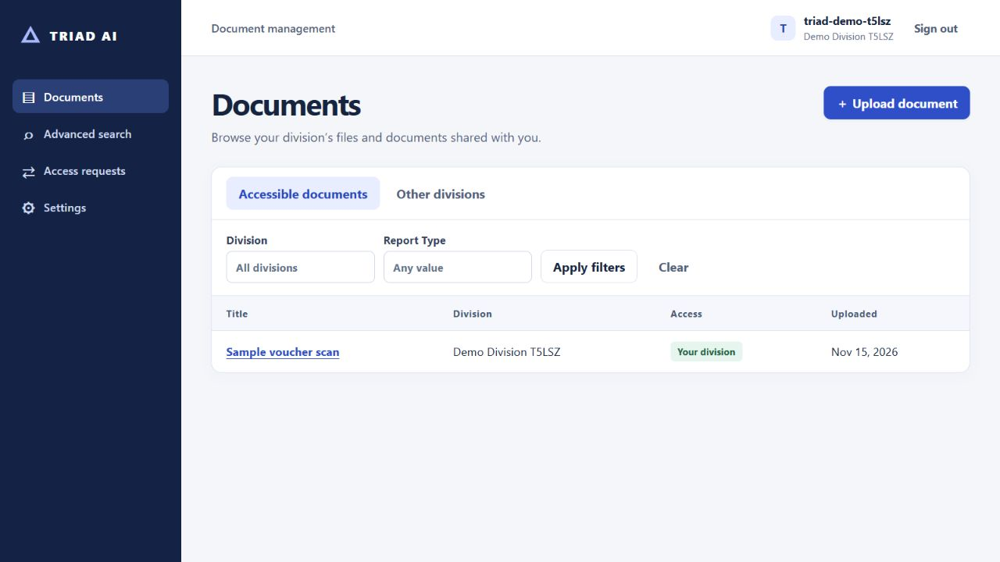
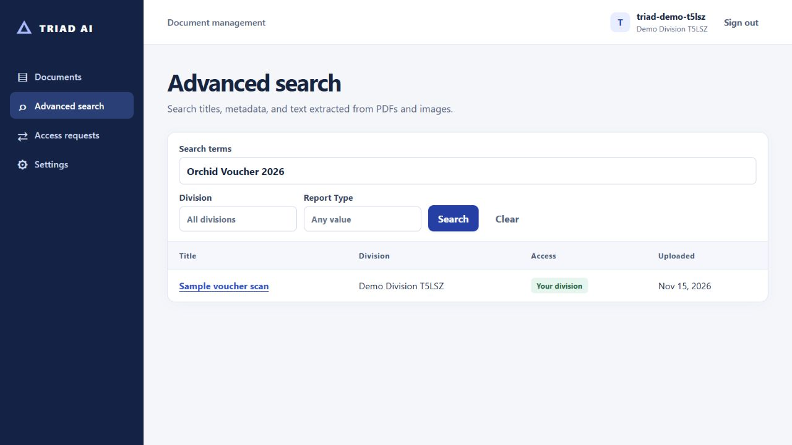

# TRIAD AI Document Management System

Upload PDFs and images, tag them with custom metadata, and find them by title, tags, or text inside a scan. Each document belongs to a division. Its members can review access requests from other divisions.

**[Open the live Hugging Face demo](https://huggingface.co/spaces/Shanmuk4622/autosource)** · [Read the user and code guide](docs/README.md) · [Check app health](https://shanmuk4622-autosource.hf.space/api/health)

Create a demo account and use sample documents. The hosted database may reset when the Space rebuilds.

## Screenshots from the live demo

**Documents** — Browse your division's files and documents shared with you.



**Advanced search** — The query `Orchid Voucher 2026` finds the sample PDF by text inside the scan.



[Sign-in screen](docs/screenshots/01-sign-in.jpg) · [Upload form](docs/screenshots/03-upload.jpg)

## Run locally with Docker

Start Docker Desktop in Linux container mode. Run this command from the repository root.

```powershell
docker compose up --build --wait
```

Open [http://localhost:7860](http://localhost:7860). Compose starts Flask and MongoDB and installs Tesseract inside the app image. The named MongoDB volume keeps users, metadata, and files across normal stops. If port `7860` is in use, set `APP_PORT=7861` in `.env` and open that port.

Stop the services with `docker compose down`.

## Project guides

| Guide | What it covers |
| --- | --- |
| [User and code guide](docs/README.md) | What each screen does, a walkthrough, and where to find the code |
| [Architecture and tool choices](docs/ARCHITECTURE.md) | Request flows, database model, authorization, and why each tool was chosen |
| [REST API](docs/API.md) | Endpoints, payloads, and examples |
| [Testing](docs/TESTING.md) | Integration suite, assignment starter test, and manual checks |
| [Setup and deployment](docs/DEPLOYMENT.md) | Windows Python or Conda, GitHub, and Hugging Face Spaces |
