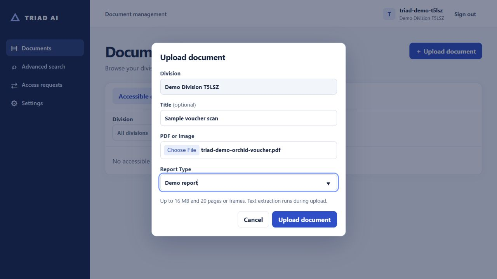

# Triad AI user and code guide

[Open the live demo](https://huggingface.co/spaces/Shanmuk4622/autosource) · [Project overview](../README.md)

## What the app does

The Document Management System gives each division a place to store PDFs and images. **Metadata** means labels stored with the document, such as its **Report Type**. **OCR** means optical character recognition. It turns words in a scanned page or image into text you can search. Cross-division access is granted to one user for one document after approval by a member of the owning division.

| Screen | What you can do |
| --- | --- |
| **Sign in / Create account** | Create an account with a username, division, and password, then sign in. Email is optional. |
| **Documents** | Upload a file, filter accessible documents, or browse the **Other divisions** catalog. |
| **Document details** | View metadata and download an accessible file. For a restricted file, see its title and division and request access. |
| **Advanced search** | Find documents in your division or shared with you by title, metadata, or extracted text. Refine results with field filters. |
| **Access requests** | Approve or reject incoming requests for files owned by your division. |
| **Settings** | See available metadata fields. Admins can also add or edit fields and their suggested values. |

## Upload and find a scan

1. Open the live demo, select **Create account**, and enter a unique username, **Division A**, and a password of at least six characters. Then sign in.
2. In **Documents**, select **Upload document**. Choose a sample PDF or image with a distinctive word visible in the file. The app assigns it to your division.
3. Enter a title and, if available, a **Report Type**. Select **Upload document**. The app extracts text during upload and opens the document details page when it finishes.
4. Go to **Advanced search**, enter a word from inside the file, and select **Search**. To check OCR specifically, use a word that appears only in the scanned image, outside the title, filename, and metadata.
5. Open the matching document and select **Download** to retrieve the original file.

The hosted database can reset on rebuild. Use sample files on Hugging Face. The upload request limit is 16 MiB, with up to 20 PDF pages or image frames.



## Share a file with another division

1. Create a second account in **Division B**. Use a separate browser profile or sign out and back in to switch between the accounts.
2. As the Division B user, open **Documents**, select **Other divisions**, and open the sample file from Division A. Select **Request access**. The details page shows **Pending** while the original file and metadata are still restricted.
3. As the Division A user, open **Access requests** and select **Approve** for the request. Selecting **Reject** keeps the file restricted.
4. Switch back to the Division B account, reopen the document, and select **Download**. The approved document also appears in that account's accessible documents and search results.

## Manage metadata fields

In a local Docker run, register a user and promote that account. Substitute its username for `alice`.

```powershell
docker compose exec app flask --app dms make-admin alice
```

Open **Settings** as that user. Select **Add field** to create a label such as **Project**, or **Edit** to rename an existing field. Suggested values are optional and users can also enter their own values. Flask keeps the field's internal ID so a label change preserves values already saved on documents.

## How an upload becomes searchable

1. The browser sends the file and its metadata to Flask. Flask checks who signed in and uses that account's division as the owner.
2. PDFium reads text already embedded in a PDF and renders scanned pages to images when needed. Tesseract reads text from those images and from uploaded image files.
3. GridFS stores the original file. MongoDB stores its title, division, metadata, extracted text, and a reference to the GridFS file.
4. When someone searches, Flask looks for matches in the title, metadata, and extracted text, filtered to files that person is allowed to access. Flask checks the same permissions before returning a download.

## Where to find the code

| File | Responsibility |
| --- | --- |
| [`dms/templates/index.html`](../dms/templates/index.html) and [`dms/static/app.js`](../dms/static/app.js) | Screens and forms, plus the browser calls to the Flask API. |
| [`dms/__init__.py`](../dms/__init__.py) | Creates the Flask app, connects to MongoDB, and registers routes. |
| [`dms/auth.py`](../dms/auth.py) | Registers users, checks passwords, signs session tokens, and handles admin setup. |
| [`dms/documents.py`](../dms/documents.py) and [`dms/ocr.py`](../dms/ocr.py) | Uploads, browsing, search, downloads, and text extraction. |
| [`dms/requests.py`](../dms/requests.py) and [`dms/fields.py`](../dms/fields.py) | Cross-division access requests and metadata field settings. |
| [`compose.yaml`](../compose.yaml) and [`Dockerfile`](../Dockerfile) | Local service setup and the app's Docker image. |

For the underlying data model, tools, and permission rules, see the [architecture guide](ARCHITECTURE.md). For example API requests and automated checks, see the [REST API](API.md) and [testing guide](TESTING.md).
